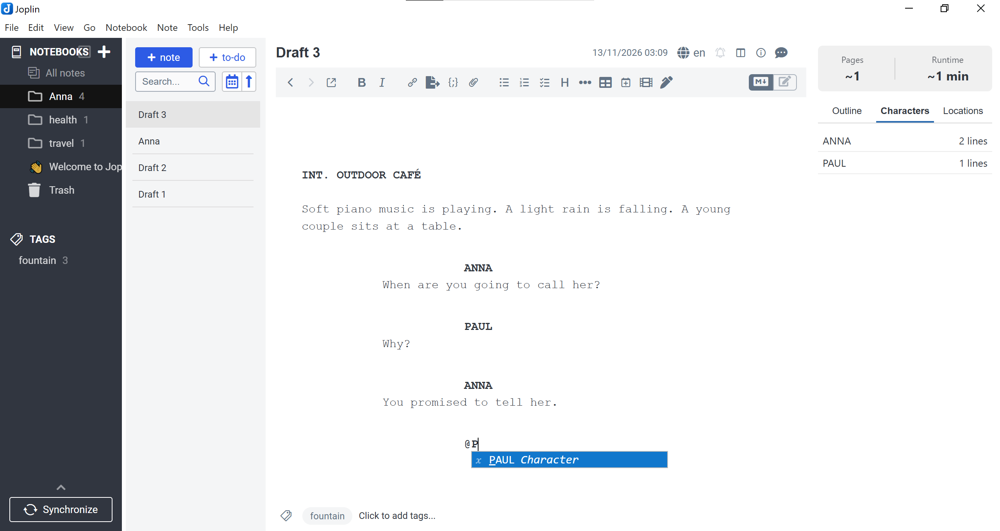

<div align="center">
  <h1>Joplin Scriptwriter Plugin</h1>
  <p>
  <i>This is a plugin for <a href="https://github.com/laurent22/joplin">Joplin</a>. Refer to <a href="https://github.com/laurent22/joplin/tree/dev/packages/app-cli/tests/support/plugins/toc/">joplin toc</a>.</i>
  </p>
  <p>
    
    
    
    
    
    
  </p>
  <hr>
</div>

A screenwriting plugin for **Joplin** built around the plain-text [Fountain](https://fountain.io) markup standard. Write scripts with industry-standard visual formatting, a two-key (`Tab` / `Enter`) workflow inspired by **KIT Scenarist** and **Story Architect (STARC)**, live runtime estimation, outline navigation, and US-standard PDF export.



## Features

- **100% Pure Fountain Storage:** Your notes stay clean, valid Fountain plain text without proprietary XML or hidden markup. Visual indentation and typography are applied dynamically inside the CodeMirror 6 Markdown editor.
- **Per-Note Screenplay Mode:** Toggle screenplay mode for any note with a single click on the **filmstrip icon** in the editor toolbar (managed cleanly via the `fountain` tag).
- **Two-Key Workflow (`Tab` & `Enter`):**
  - **Cyclic `Tab` on empty lines:** `Empty line` → `Character (@)` → `INT. ` → `EXT. ` → `Empty line`.
  - **`Tab` on filled blocks:** `Character` → `Parenthetical ()`, `Dialogue` → `Parenthetical ()`, `Action` → `Transition (> CUT TO:)`.
  - **Quick Dialogue `Enter` workflow:** Pressing `Enter` after a `Character` formats the name in uppercase and jumps to `Dialogue`. Pressing `Enter` after a `Dialogue` line automatically starts a new `Character` (`@`). Pressing `Enter` twice on an empty dialogue line exits back to `Action`.
- **Step-by-Step Smart Autocomplete:**
  1. Scene prefixes (`INT.`, `EXT.`, `INT./EXT.`, `I/E.`, `EST.`).
  2. Locations collected from the current script and project bible.
  3. Time of day after ` - ` (`DAY`, `NIGHT`, `MORNING`, `EVENING`, `CONTINUOUS`, etc.).
  4. Character names when typing `@` or uppercase letters.
- **Hybrid Project Dictionary (`#fountain-bible`):** Automatically gathers characters and locations from the active script, all other `#fountain` notes in the same notebook, and optional reference notes tagged with `fountain-bible`.
- **Screenplay Side Panel:**
  - Live page count and runtime estimation (`~1 page = 1 minute`).
  - Interactive hierarchical **Outline** (Sections `#`, Scene Headings, and toggleable Synopses `=`) with click-to-scroll navigation.
  - **Characters** list (with dialogue line counts) and **Locations** index.
- **US-Standard PDF & `.fountain` Export:**
  - Export via **Note → Export → Fountain Screenplay (PDF)** or **Fountain Screenplay (.fountain)**.
  - Configurable title page (`Title`, `Credit`, `Author`, `Source`, `Draft date`, `Contact`), optional scene numbering, synopsis inclusion, and automatic saving of title metadata back to the note header.
  - Uses US Letter format (`1.5"` left margin, `1"` top/right/bottom margins, `12pt` monospace font) with full **Cyrillic** and Latin support.

---

## Installation

### From Release (`.jpl`)
1. Download the latest `.jpl` file from the [Releases](https://github.com) page.
2. Open **Joplin** → **Tools** → **Options** (or **Joplin** → **Settings** on macOS) → **Plugins**.
3. Click the **gear icon** ⚙️ next to the search bar and select **Install from file**.
4. Choose the downloaded `.jpl` file and restart Joplin.

### Building from Source
```bash
git clone https://github.com
cd joplin-plugin-scriptwriter
npm install
npm run dist
```
The compiled `.jpl` archive will be generated inside the `publish/` directory.

---

## Usage Guide

1. **Switch to the Markdown Editor:** Make sure Joplin is in **Markdown editor mode** (`M↓` icon in the top-right corner of the editor), as CodeMirror plugins are active in Markdown mode.
2. **Activate Screenplay Mode:** Click the **filmstrip icon** on the editor toolbar. The note will be tagged with `fountain`, and the screenplay side panel will appear.
3. **Create a Series / Project Bible (Optional):**
   Create a note in the same notebook, assign the tag `fountain-bible`, and list recurring characters and locations under `## Characters` and `## Locations`:
   ```markdown
   ## Characters
   - ALEX
   - MARIA

   ## Locations
   - ALEX'S APARTMENT
   - COFFEE SHOP
   ```
4. **Export Your Script:**
   Right-click the note in the note list (or open **Note → Export**) and select:
   - **Fountain Screenplay (PDF)** — configure title page fields and export a formatted PDF.
   - **Fountain Screenplay (.fountain)** — export a clean `.fountain` file compatible with Final Draft, Story Architect (STARC), KIT Scenarist, Highland, and Fade In.

---

## Plugin Settings

Go to **Options / Settings → Fountain Screenplay** to configure:
- **Default Author:** Pre-fills the `Author` field in the PDF export dialog.
- **Default Contact Info:** Pre-fills the `Contact` field in the PDF export dialog.
- **Scene marker languages:** Comma-separated list of active marker locales (default: `en`).

---

## License

MIT
